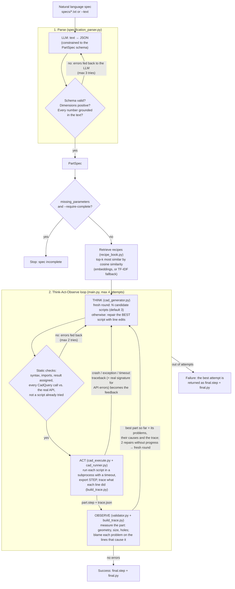
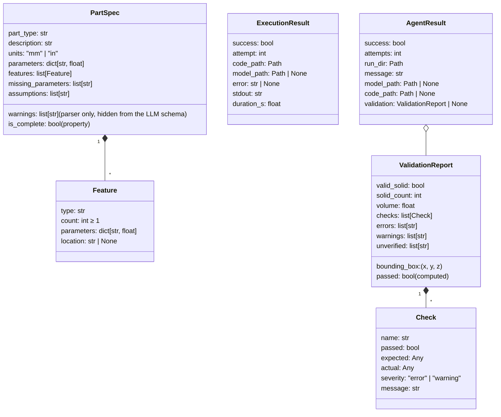

# agentic-ai-cad-design

This repository builds a small AI agent that turns a written part specification into a valid parametric 3D CAD model. The agent checks its own output and fixes its mistakes.

You give it a sentence like:

> Wheel spacer disc 150 mm diameter, 20 mm thick, center bore 65 mm diameter, 5 bolt holes each 15 mm diameter

and it returns a [CadQuery](https://cadquery.readthedocs.io/) script plus a STEP model. The model has been measured against the specification, and the agent iterated until it matched or ran out of attempts.

Everything runs locally: the LLM is served by [Ollama](https://ollama.com/) (default model `qwen2.5-coder:3b`), and the geometry is built and measured with CadQuery / OpenCascade. To keep the model from inventing CadQuery syntax, every generated call is checked against the real installed API, and the prompt includes the validated recipes most similar to the requested part.

---

## Contents

1. [Quick start](#quick-start)
2. [Repository layout: where things go](#repository-layout-where-things-go)
3. [Process flow](#process-flow)
4. [Stage by stage](#stage-by-stage)
5. [Data models (`schemas.py`)](#data-models-schemaspy)
6. [Module and function reference](#module-and-function-reference)
7. [How the modules interact](#how-the-modules-interact)
8. [Outputs of a run](#outputs-of-a-run)
9. [Prompts](#prompts)
10. [Recipe book and CadQuery API grounding](#recipe-book-and-cadquery-api-grounding)
11. [Configuration](#configuration)
12. [Logging and debugging](#logging-and-debugging)
13. [Testing](#testing)
14. [Known limitations and next steps](#known-limitations-and-next-steps)

---

## Quick start

### Requirements

- Python ≥ 3.12 and [uv](https://docs.astral.sh/uv/)
- [Ollama](https://ollama.com/) running locally (`ollama serve`) with the model pulled:

```bash
ollama pull qwen2.5-coder:3b
ollama pull nomic-embed-text   # optional: embeddings to rank recipes; without it TF-IDF is used
```

### Install

```bash
uv sync --all-extras
source .venv/bin/activate   # or let direnv load .envrc
```

### Run the agent

Commands are run from the repository root. The modules in `src/` import each other by plain module name, so they are started as scripts (`python src/<module>.py`).

```bash
# From a spec file (the file name becomes the run folder name)
uv run python src/main.py specs/wheel_spacer.txt -v

# From text on the command line
uv run python src/main.py --text "Plate 100 x 50 mm, 5 mm thick, four 6 mm holes" --name plate -v

# See the LLM's answers live while they are generated
uv run python src/main.py specs/bracket.txt -v --stream

# Try a bigger model
uv run python src/main.py specs/bracket.txt -v --model qwen2.5-coder:7b

# Show 3 recipes instead of 2, or rank them without the embedding model
uv run python src/main.py specs/bracket.txt -v --recipes 3 --no-embeddings
```

Exit codes: `0` the part passed validation, `1` it did not pass within the attempts (the best attempt is still saved), `2` the specification could not be parsed or the LLM could not be reached.

### Run a single stage

Every stage has its own command line, which is useful to debug one step in isolation:

```bash
uv run python src/specification_parser.py specs/wheel_spacer.txt        # -> outputs/wheel_spacer.spec.json
uv run python src/cad_generator.py outputs/wheel_spacer.spec.json > ws.py
uv run python src/cad_execute.py ws.py                                  # -> outputs/runs/ws_<timestamp>/attempt_1/part.step
```

---

## Repository layout: where things go

```
agentic-ai-cad-design/
├── specs/                     # INPUT: natural language specifications, one plain .txt file per part
│   ├── wheel_spacer.txt
│   ├── bracket.txt
│   └── underspecified.txt     # deliberately incomplete, to test how the agent handles missing values
├── prompts/                   # LLM PROMPT TEMPLATES (Markdown with {placeholders}), loaded at run time
│   ├── parse_specification.md # natural language -> structured JSON spec
│   ├── generate_cad_code.md   # structured spec -> first CadQuery script
│   └── repair_cad_code.md     # spec + previous script + problems -> corrected script
├── recipes/                   # RECIPE BOOK: validated CadQuery scripts, the most similar ones are shown to the LLM
│   ├── l_bracket_holes_in_both_legs.py
│   ├── round_flange_bolt_circle.py
│   └── ...                    # 15 recipes: plates, flanges, tubes, shells, slots, profiles, revolves, pockets...
├── src/                       # THE AGENT
│   ├── main.py                # entry point and Think-Act-Observe loop
│   ├── specification_parser.py# stage 1: parse the specification
│   ├── cad_generator.py       # stage 2 (Think): write a script / repair one with line edits
│   ├── cad_execute.py         # stage 3 (Act): run the script in a subprocess
│   ├── cad_runner.py          # helper executed inside that subprocess, exports STEP and trace.json
│   ├── build_trace.py         # traces what each line does to the part, blames problems on lines
│   ├── validator.py           # stage 4 (Observe): measure the part against the spec
│   ├── recipe_book.py         # loads the recipes and retrieves the most similar ones (embeddings or TF-IDF)
│   ├── cadquery_api.py        # real CadQuery signatures/docs: static API check, error help, reference cards
│   ├── llm_client.py          # the only module that talks to Ollama
│   └── schemas.py             # Pydantic data models shared by all stages
├── outputs/                   # GENERATED: never edit by hand, safe to delete
│   ├── <name>.spec.json       # written by specification_parser.py when run on its own
│   ├── cache/                 # recipe embeddings, recomputed only when a recipe's text changes
│   └── runs/<name>_<timestamp>/   # one folder per agent run (see "Outputs of a run")
├── tests/                     # pytest suite (fake LLM, real CadQuery)
├── pyproject.toml             # dependencies, ruff / pytest / coverage configuration
└── .envrc                     # direnv: sync and activate the virtual environment
```

| You want to... | Put it in | Notes |
|---|---|---|
| Add a new part to try | `specs/<name>.txt` | Plain text, one specification per file. The file name (without `.txt`) names the run folder. |
| Change how the LLM is instructed | `prompts/*.md` | Keep the `{placeholders}` (see [Prompts](#prompts)). No code change needed: prompts are read on every call. |
| Teach the agent a new way of building something | `recipes/<name>.py` | See [Recipe book](#recipe-book-and-cadquery-api-grounding). The tests execute every recipe, so run `uv run pytest tests/test_recipe_book.py` after adding one. |
| Add a new prompt | `prompts/<name>.md` | Load it with `Path.read_text()` and fill it with `str.replace("{placeholder}", value)`, like the existing modules. |
| Find generated models, code and logs | `outputs/runs/<name>_<timestamp>/` | Created automatically. |
| Add a test | `tests/test_<module>.py` | `tests/fakes.py` has `FakeLLM` for tests without Ollama. |

---

## Process flow

The agent has a **parse** step followed by a **Think → Act → Observe** loop:



Every error the agent sees comes from a deterministic check (schema, AST, real API signatures, Python exception, geometric measurement), never from the LLM judging itself. The LLM only writes; the code measures.

---

## Stage by stage

### 1. Parse: natural language → `PartSpec` (`specification_parser.py`)

**Goal:** turn free text into a structured, checkable description of the part, without inventing values.

1. The prompt `prompts/parse_specification.md` is filled with the specification text.
2. The LLM is called with Ollama's `format=` option set to the JSON schema of `PartSpec`. This *constrains decoding*: even a small model can only produce JSON with the right shape.
3. The answer is validated with Pydantic (`PartSpec.model_validate_json`). Code fences (```` ```json ````) are stripped first.
4. `check_spec` runs deterministic checks:
   - every dimension is positive;
   - **grounding**: every dimension in the output must appear in the original text, or be mentioned in an `assumptions` entry. This catches invented values (e.g. a bolt circle of 114.3 mm that the text never mentions);
   - **coverage**: every number in the text must appear somewhere in the output, so nothing is dropped;
   - counts the model derived (e.g. "two holes in each leg" → `count: 4`) are only a **warning**, because that is a legitimate inference.
5. If there are errors, they are appended to the conversation and the LLM tries again (up to `MAX_PARSE_ATTEMPTS = 3`).
6. Result:
   - no schema-valid answer at all → `SpecParseError`;
   - schema-valid but some checks still fail → the attempt with the fewest errors is returned, with the remaining problems in `spec.warnings`.

Values the specification does not give (hole positions, a bolt circle diameter...) must go to `missing_parameters` instead of being made up.

### 1b. Retrieve recipes (`recipe_book.py`)

**Goal:** show the LLM working code for parts like this one, on top of the two generic examples that are always in the generation prompt.

Once per run, right after parsing, `find_recipes` ranks every recipe in `recipes/` by cosine similarity to the spec and keeps the top k (default 2). The chosen recipes go into every generate and repair prompt of the run, and their names and scores are saved to `recipes.json`. Details in [Recipe book and CadQuery API grounding](#recipe-book-and-cadquery-api-grounding).

### 2. Think: `PartSpec` → CadQuery script (`cad_generator.py`)

**Goal:** produce a script that builds the part and assigns it to `result`, either a new one or a repair of the best one so far.

1. Two kinds of prompt:
   - **new script** (`generate_cad_code` → `build_prompt`): `prompts/generate_cad_code.md`, which has rules, a list of useful CadQuery patterns and **two fixed generic examples** (a rectangular plate with corner holes, a round flange with holes on a circle), shown with or without recipes. Retrieved recipes are added after them; the two recipes that are copies of these examples (`EXAMPLE_RECIPES` in `cad_generator.py`) are skipped in this prompt so they are not shown twice, but their methods stay in the API reference;
   - **repair** (`repair_cad_code` → `build_repair_prompt`): `prompts/repair_cad_code.md`, with the spec, the script **with line numbers**, the problems, **where they come from** (the lines the build trace blames, see stage 4b) and **what each line did to the part**. It starts a fresh conversation, so the context stays short for a small model. See [Repairs with line edits](#repairs-with-line-edits) below.
   - After repairs stall, a new script is asked for with a **"A previous approach failed"** section listing the problems that the repairs could not fix, so the model tries a different approach.
2. Both templates get the spec as JSON (without the parser-only `warnings` field), the **retrieved recipes**, and an **API reference**: real signatures and one-line descriptions of the core positioning methods plus every method the recipes use (`cadquery_api.api_reference`, at most 12 cards).
3. The LLM answers. `extract_code` takes the first ```` ```python ```` block.
4. `check_code` parses the code into an AST and checks it **before anything runs**:
   - valid syntax;
   - `import cadquery as cq` present, and only `cadquery` and `math` imported;
   - no calls to `open`, `exec`, `eval`, `compile`, `__import__`, `input`, `print`, `show`, `show_object` or `export`;
   - a variable named `result` is assigned;
   - **every CadQuery method call exists and accepts its arguments** (`cadquery_api.check_api_calls`). An invented method or argument is reported with the real signature, its documentation and a "did you mean". For example, `.workplane(centerX=40)` gets back `Did you mean the method .center()?` with `Workplane.center(x, y)`.
5. If a check fails, the errors go back to the LLM in the same conversation (up to `MAX_GENERATION_ATTEMPTS = 2`). These failures are cheap and do **not** use up an attempt of the main loop. If it still fails, `CodeGenerationError` is raised. A script identical to one already executed (comments and formatting ignored, `fingerprint`) is rejected the same way, and the retry samples at a higher temperature (0.7).

#### Repairs with line edits

A small model given "fix this script" tends to copy it back unchanged or rewrite it from scratch. A repair is therefore an edit, not a rewrite. The LLM answers with JSON constrained to `RepairPlan` (Ollama `format=`):

```json
{
  "diagnosis": "Line 16 extrudes the bore circle, which adds 10 mm on top instead of cutting a hole.",
  "edits": [
    {"first_line": 15, "last_line": 16, "replacement": "    .hole(center_bore_diameter)"}
  ]
}
```

- The `diagnosis` comes first, so the model names the cause before it writes the fix. It is logged and saved in `log.json`.
- `apply_edits` replaces each line range of the **original** script (bottom-up, so the numbers stay valid). It rejects empty, out-of-range and overlapping edits, and removes code fences or copied line numbers (`  7| `) from the replacement.
- The repaired script then goes through the same static checks and the "already tried" check. Any problem goes back to the model in the same conversation, reminding it that line numbers refer to the original script.

The prompt requires a `# ASSUMED: <reason>` comment for every value chosen for a `missing_parameters` entry, so every choice the model made can be traced.

### 3. Act: run the script (`cad_execute.py` + `cad_runner.py`)

**Goal:** turn the script into a STEP file without risking the agent process.

1. `execute_cad_code` writes the script to `run_dir/attempt_<n>/part.py`, or `run_dir/attempt_<n>/candidate_<k>/part.py` for the candidates of a fresh round.
2. It starts a **separate Python process** (`python -I src/cad_runner.py part.py part.step`) with a timeout (`EXECUTION_TIMEOUT_S = 120`). OpenCascade can segfault or hang on bad geometry. In a subprocess, a crash, hang or infinite loop becomes an error message instead of killing the agent.
3. Inside the subprocess, `cad_runner.main`:
   - executes the script **with tracing** (`build_trace.run_traced`, see stage 4b) and writes `trace.json` next to `part.py`, also when the script fails;
   - on an exception, prints a traceback **filtered to the lines of `part.py`**, so the feedback points at the generated code and not at CadQuery internals:
     ```
     File "part.py", line 4, in <module>
       result = result.edges().fillet(50)
     OCP.OCP.StdFail.StdFail_NotDone: BRep_API: command not done
     ```
   - checks that `result` exists, is a `cq.Workplane` or `cq.Shape`, and contains at least one solid (catching "forgot to extrude");
   - exports it to `part.step`.
4. The outcome is returned as an `ExecutionResult`: success, error text, paths, stdout and duration.
5. When the error is a CadQuery `TypeError` or `AttributeError` that the static check could not see (e.g. the chain went through a list), `main` adds the real signature to the feedback (`cadquery_api.explain_runtime_error`).

> The subprocess isolates crashes; it is **not** a security sandbox. Together with the static checks this is enough for a local model and your own specs. Use a container if specifications ever come from untrusted sources.

### 4. Observe: measure the part (`validator.py`)

**Goal:** compare the real geometry with the spec, and explain any difference in words the LLM can act on.

`validate_model` loads `part.step` and runs these checks. They only use the `PartSpec`, so they work for any part type:

| Check | How | Severity |
|---|---|---|
| `valid_geometry` | OpenCascade `isValid()` | error |
| `single_solid` | exactly one solid (disconnected bodies are a common mistake) | error |
| `positive_volume` | volume > 0 | error |
| `size:<param>` | base parameters whose name contains length / width / height / depth / diameter must match a bounding box size (a diameter must match two of them) | error |
| `size:<thickness>` | thickness must match a bounding box size | error if some bounding box size is unexplained, otherwise warning (an L-bracket's wall thickness is not one of its bounding box sizes) |
| `size:unexplained` | a bounding box size that matches no parameter, e.g. something extruded on top | warning |
| `holes:<d>` | number of **complete** holes of each diameter equals the count in the spec. If cuts of that diameter break through the edge of the part, the message says their positions are wrong | error |
| `holes:unsized` | hole features without a diameter in the spec: only their number is checked, any diameter is accepted | error |
| `extra_holes:<d>` | complete holes that are not in the spec | error |
| `partial_cuts:<d>` | round cuts that do not go all the way around and match nothing in the spec | warning |
| `assumptions_declared` | the spec has missing parameters, but the code has no `# ASSUMED:` comment | warning |

**How holes are detected** (`find_concave_cylinders`): every cylindrical face is classified by comparing its surface normal with the direction to its axis:

- **concave** (normal points to the axis) = a cut into the material, such as a hole, a bore or an inner rounded corner;
- **convex** = the outside of the part, such as the rim of a disc or a rounded outer corner. These are ignored.

Concave faces that share a diameter and an axis line are one feature, even when OpenCascade splits it into several faces. Their angles are added up: 360° makes a **complete hole**, less makes a **partial cut** (a hole breaking out through an edge, or an inner rounded corner).

Expected holes come from features whose type contains `hole` or `bore`, and from base parameters such as `center_bore_diameter`. A bore listed in both places is counted once.

Anything the validator cannot measure (e.g. a bolt circle diameter or a fillet radius) is listed in `report.unverified`, never silently counted as passing.

The error messages are written as instructions, because a small model otherwise "fixes" the specification instead of the geometry:

```
The specification requires thickness = 20, but the part measures 150 x 150 x 30.
Keep thickness = 20: the geometry is wrong, not the value.
```

Tolerance: two values match when they differ by less than 0.01 mm or 0.1 %, whichever is larger (`ABS_TOL`, `REL_TOL`).

### 4b. Find the cause: the build trace (`build_trace.py`)

**Goal:** turn "found 0 holes" into "line 35 filled them", which a small model can act on.

**Instrumenting the script.** The runner does not execute the script as written. `instrument` rewrites every method call `x.m(a)` into `__trace_after__(__trace_before__(x, i).m(__trace_arg__(a, i)), i)`. The script computes exactly the same thing, but a `Tracer` measures the solid going into each call (the receiver and any solid arguments, e.g. the body passed to `.union()`) and coming out of it:
- the bounding box size;
- the volume;
- the number of solids;
- the complete holes and the broken-out cuts, by diameter (the same `find_concave_cylinders` the validator uses).

Calls that change the geometry, and cuts or unions that should have changed it, become records in `trace.json` with the line number of the method name, so `.hole(...)` on line 21 of a multi-line chain is blamed on line 21. Calls on `cq` and `math` are not wrapped, and the trace stops at 300 records. A measurement that fails is skipped: tracing never breaks the script.

**Blaming the lines** (`locate_problems`). Each failed check is matched with the records that explain it:

| Problem | Cause reported |
|---|---|
| missing holes | the line where complete holes **disappeared** (e.g. a `.union()` whose other body fills them); the line whose cuts **break out** of the body they were made in, with that body's size; or "no line of the script makes a complete hole of diameter d" |
| too many / too few holes | every line that makes holes of that diameter, and how many each makes |
| wrong size | the line that introduced a size no dimension explains (`.extrude(thickness / 2)` changes 150 x 150 x 20 to 150 x 150 x 30); otherwise every line that changed the size |
| several solids | the line after which the part is split into separate solids |
| any failure | cuts that **remove no material** (positions outside the body) and unions that **add no material** (the joined body lies inside the other one) |

`format_trace` adds a short "what each line did" list, e.g. `- line 16 .extrude(thickness / 2) -> size 150 x 150 x 30, volume 386612, holes none`. Both go into the repair prompt and into `log.json` (`problem_locations`).

### 5. The loop (`main.py`)

`_run_loop` ties the stages together. A round of candidates counts as one attempt:

```
recipes = find_recipes(spec, k)          # once per run
best = None; stalled = 0
for attempt in 1..max_attempts:                       # default 4
    if best is None or stalled >= STALL_LIMIT (2):
        THINK  fresh round: generate CANDIDATES (3) scripts
               (candidate 1 at temperature 0.2, the others at 0.8; after a stall all at 0.8 with
                "a previous approach failed: <problems of the best script>")
        each:  ACT + OBSERVE (_evaluate), stop the round early if one passes
        stalled = 0
    else:
        THINK  repair the BEST script: diagnosis + line edits, guided by its problems, their causes and its trace
        ACT + OBSERVE (_evaluate)
        stalled += 1
    if a script passed → copy it to final.step / final.py and return success
    if the best of this attempt has fewer errors than `best` → it becomes `best`, stalled = 0
    on a tie → it becomes `best` too (the next repair explores from the newer script)
    if it is worse → it is thrown away; the next repair starts again from `best`
out of attempts → return `best` (fewest errors) as a failure
```

`_evaluate(code)` is one Act + Observe: `execute_cad_code`, then `validate_model`, then `locate_problems` and `format_trace` from the script's `trace.json`, then `log.json`. The result is an `Outcome`: the code, the `ExecutionResult`, the `ValidationReport`, the problems (errors and `(warning)` lines, or the traceback), their causes and the trace. Outcomes are ranked by `score`: a part beats a failed execution, then fewer errors, then fewer warnings.

Design decisions:

- **Breadth first.** In the recorded runs every success came from a first try, and no repair ever reduced the number of errors. Several independent first tries are cheap (one LLM call and about 2 s of execution each) and raise the chance that one is right or close.
- **Repair the best, locally.** Repairs always start from the best part so far and change only the lines the trace blames, so what already works is kept and a bad repair is simply discarded.
- **Restart when stuck.** After `STALL_LIMIT` repairs in a row without fewer errors, the agent stops polishing a wrong design and generates a fresh round of candidates, telling the model which problems the old approach could not fix.
- **Warnings are part of the feedback.** They do not fail a part on their own, but they often explain the errors.
- **Rejecting already-tried scripts**: every executed script is remembered. A new script or repair identical to one of them (comments and formatting ignored) is sent back as a static error, so no attempt is spent running a script that already failed.
- **Missing parameters** do not stop the run by default: the generator chooses values and marks them `# ASSUMED:`. With `--require-complete` the run stops right after parsing and lists what is missing. This suits `specs/underspecified.txt`.

---

## Data models (`schemas.py`)

All data passed between stages is a Pydantic model, so it is validated and serializable to JSON.



| Model | Produced by | Consumed by |
|---|---|---|
| `PartSpec`, `Feature` | `specification_parser.parse_specification` | `cad_generator`, `validator`, `main` |
| `ExecutionResult` | `cad_execute.execute_cad_code` | `main` |
| `Check`, `ValidationReport` | `validator.validate_model` | `main` (feedback, logs, best-attempt choice) |
| `AgentResult` | `main.run_agent` | the CLI (`print_summary`), `result.json` |

Example `PartSpec` (as written to `spec.json`):

```json
{
  "part_type": "wheel_spacer",
  "description": "Disc with a center bore and five bolt holes",
  "units": "mm",
  "parameters": {"diameter": 150, "thickness": 20},
  "features": [
    {"type": "center_bore", "count": 1, "parameters": {"diameter": 65}, "location": "center"},
    {"type": "through_hole", "count": 5, "parameters": {"diameter": 15}, "location": "around the center"}
  ],
  "missing_parameters": ["bolt circle diameter"],
  "assumptions": ["holes go through the full thickness"],
  "warnings": []
}
```

---

## Outputs of a run

Each `run_agent` call creates its own folder, so nothing is overwritten and attempts can be compared:

```
outputs/runs/wheel_spacer_20261027_201722/
├── input.txt          # the natural language specification as given
├── spec.json          # the parsed PartSpec, including parser warnings
├── recipes.json       # recipes shown to the LLM in this run, with their similarity
├── run.log            # full log, DEBUG level: every prompt and every raw LLM answer
├── attempt_1/         # a fresh round: one folder per candidate
│   ├── candidate_1/
│   │   ├── part.py    # the generated script
│   │   ├── part.step  # the exported model (only if execution succeeded)
│   │   ├── trace.json # what each line did to the part (also written when the script fails)
│   │   └── log.json   # ExecutionResult, ValidationReport, problem_locations
│   ├── candidate_2/ ...
├── attempt_2/         # a repair of the best script so far
│   ├── part.py, part.step, trace.json
│   └── log.json       # feedback received, the LLM's diagnosis, results, problem_locations
├── attempt_3/ ...
├── final.py           # copy of the passing attempt (or the best one when the run failed)
├── final.step
└── result.json        # the AgentResult
```

To see why an attempt looks the way it does, read its `log.json` (`feedback_received` is what the LLM was told, `diagnosis` what it thought was wrong, `problem_locations` which lines the trace blamed) next to its `part.py`, and search `run.log` for the full prompt. STEP files open in FreeCAD or any CAD viewer.

`outputs/` contains only generated files and can be deleted at any time. It is ignored by git, as are `*.spec.json` files and CAD exports such as `*.step` and `*.stl` (see `.gitignore`).

---

## Prompts

Prompts live in `prompts/` as Markdown. They are read from disk on every call, so editing them needs no code change. Placeholders are plain `{name}` strings replaced with `str.replace` (not `str.format`), so JSON braces inside the prompts are safe.

| File | Used by | Placeholders | Purpose |
|---|---|---|---|
| `parse_specification.md` | `specification_parser._load_prompt` | `{specification}` | Extraction rules (copy numbers exactly, holes and bores are features, never invent values, list missing ones) and one worked example. |
| `generate_cad_code.md` | `cad_generator.build_prompt` (first attempt) | `{recipes}`, `{api_reference}`, `{specification}` | CadQuery rules, useful API patterns, two fixed generic examples, the retrieved recipes and the API reference. |
| `repair_cad_code.md` | `cad_generator.build_repair_prompt` | `{recipes}`, `{api_reference}`, `{specification}`, `{problems}`, `{locations}`, `{trace}`, `{numbered_code}` | Answer with a diagnosis and line edits (JSON); start from the lines the trace blames; never change spec values to match measurements; change as few lines as possible; typical causes; use the real signature instead of guessing. |

The system prompt sent with every call is `SYSTEM_PROMPT` in `src/llm_client.py`.

Tips when editing prompts:

- **Small models copy examples closely.** An example teaches its layout more strongly than any rule does. The generation prompt keeps two generic examples with different layouts (rectangular and round) so the model always has working code, even with `--recipes 0`; examples that match the part are retrieved from the recipe book and added after them. If you change an example, change its recipe in `recipes/` too, since the recipe is the tested copy.
- **Examples should not be the specs you evaluate on.** `round_flange_bolt_circle` is structurally close to `wheel_spacer.txt` and `l_bracket_holes_in_both_legs` to `bracket.txt`. To measure how well the agent generalizes, evaluate on specs that have no near-identical recipe, or run with `--recipes 0` for comparison.
- Keep the JSON in the parser example consistent with `PartSpec`, since it shows the model the expected shape.

---

## Recipe book and CadQuery API grounding

A small model knows CadQuery only from its training data, and it fills the gaps by inventing plausible syntax (a 7B model tried `workplane(centered=...)`, `center=` and `centerX=` in three attempts). Two complementary mechanisms address this:

| | Knowledge it provides | Source | When it is used |
|---|---|---|---|
| **API grounding** (`cadquery_api.py`) | how to call a method: which methods exist, which arguments they take | the installed CadQuery, via `inspect` | in every prompt (reference cards), in the static check before execution, and in runtime error feedback |
| **Recipe book** (`recipes/`, `recipe_book.py`) | how to build a kind of shape: e.g. an L-bracket is two plates joined at a right angle | validated scripts written by hand | the top-k most similar recipes go into every prompt of a run |

### Recipe format

A recipe is a complete, runnable script with a metadata docstring:

```python
"""
title: Round flange with center hole and bolt circle
description: Round disc (flange, spacer, adapter plate) with a center hole or bore and several holes evenly spaced on a bolt circle around the center.
tags: disc, round, flange, spacer, center bore, bolt circle, pitch circle, polar array
"""

import cadquery as cq

diameter = 80.0
...
result = (...)
```

- `title` and `description` are required, `tags` are optional but help retrieval. Each is one line.
- The code follows the same rules as generated code (named dimensions, `result`, `# ASSUMED:` for chosen values, only `cadquery` / `math`), because the LLM imitates it.
- Comments are worth adding where the API is not obvious (e.g. that `polarArray` takes a radius).

To add a recipe, write `recipes/<name>.py` and run `uv run pytest tests/test_recipe_book.py`. The tests check that every recipe has its metadata, passes the generator's static checks (including the API check), and builds exactly one valid solid. A recipe that fails these tests could teach the model a mistake.

### Retrieval

1. **Query.** `spec_query` turns the spec into text: part type, description, base parameter names and features, e.g. `L-shaped bracket. ... Dimensions: leg1 length, leg2 length, width, thickness. Features: 2 x through hole leg1; ...`. The part type alone is often vague (`wheel_spacer_disc`); parameter names such as `leg1_length` and feature lists such as "5 x through hole" carry most of the information about the shape.
2. **Documents.** Each recipe is represented by its title, description and tags (`Recipe.search_text`), not by its code.
3. **Similarity.** Cosine similarity between query and documents:
   - **embeddings** (`OllamaEmbedder`, default `nomic-embed-text`): understand synonyms ("spacer" ≈ "flange", "angle bracket" ≈ "L bracket"). Recipe vectors are cached in `outputs/cache/` and recomputed only when a recipe's text changes, so a run embeds just the query;
   - **TF-IDF** (`tfidf_scores`): the fallback when the embedding model is not pulled or Ollama cannot be reached. It depends on shared words, so good tags matter.
4. **Top k.** The k best recipes (default 2, `--recipes`) are used for the whole run and saved in `recipes.json` with their score.

With the current recipes, TF-IDF ranks the expected recipe first for the example specs (wheel spacer → round flange 0.55, next 0.27; bracket → L-bracket 0.74, next 0.13). The scores and the method used are logged at INFO level ("Recipes by embeddings for ..."), so you can compare both on your machine.

### Prompt budget

The context window is 8192 tokens. A generation prompt with 2 recipes and 12 API cards is about 1.7–2.3k tokens; a repair prompt with the numbered script, problems, causes and trace is about 2.2k. Raising `--recipes` above 3 or 4 starts to crowd out the specification and rules.

---

## Configuration

| Setting | Where | Default | CLI flag |
|---|---|---|---|
| LLM model | `llm_client.DEFAULT_MODEL` | `qwen2.5-coder:3b` | `--model` |
| Max length of one answer (tokens) | `llm_client.settings.max_tokens` | 1500 | `--max-tokens` |
| Max time for one answer (s) | `llm_client.settings.timeout_s` | 300 | `--llm-timeout` |
| Show answers while generated | `llm_client.settings.stream_to_terminal` | off | `--stream` |
| Context window (tokens) | `llm_client.settings.context_tokens` | 8192 | n/a |
| Think-Act-Observe attempts (a round of candidates counts as one) | `main.MAX_ATTEMPTS` | 4 | `--max-attempts` |
| Candidate scripts per fresh round | `main.CANDIDATES` | 3 | `--candidates` |
| Repairs without progress before a fresh round | `main.STALL_LIMIT` | 2 | n/a |
| Stop if the spec has missing values | `run_agent(require_complete=...)` | off | `--require-complete` |
| Recipes shown to the LLM | `recipe_book.settings.top_k` | 2 | `--recipes` (0 disables) |
| Embedding model for recipe retrieval | `recipe_book.settings.embedding_model` | `nomic-embed-text` | `--embed-model` |
| Rank recipes with TF-IDF only | `run_agent(embedder=None)` | off | `--no-embeddings` |
| API cards in the prompt | `cadquery_api.api_reference(limit=...)`, `CORE_METHODS` | 12 | n/a |
| Parse retries | `specification_parser.MAX_PARSE_ATTEMPTS` | 3 | n/a |
| Static-check retries per attempt | `cad_generator.MAX_GENERATION_ATTEMPTS` | 2 | n/a |
| Allowed imports / forbidden calls | `cad_generator.ALLOWED_IMPORTS`, `FORBIDDEN_CALLS` | `cadquery`, `math` / see stage 2 | n/a |
| Script execution timeout (s) | `cad_execute.EXECUTION_TIMEOUT_S` | 120 | n/a |
| Measurement tolerance | `validator.ABS_TOL`, `REL_TOL` | 0.01 mm, 0.1 % | n/a |
| Ollama server | environment variable `OLLAMA_HOST` | `http://127.0.0.1:11434` | n/a |

Temperatures are fixed in code: 0 for parsing (deterministic extraction); in `cad_generator`, 0.2 for the first candidate and the first try of a repair (`TEMPERATURE`), 0.8 for the other candidates (`CANDIDATE_TEMPERATURE`), and at least 0.7 for retries after a static check failed (`RETRY_TEMPERATURE`).

---

## Logging and debugging

- **Terminal:** `-v` shows each step as it starts ("Attempt 2/3: repairing the script", "Waiting for qwen2.5-coder:3b..."), how long each LLM answer took, and every validation error and warning. Without `-v` only warnings are shown.
- **`--stream`:** prints the LLM's answer token by token. Use it when a call seems stuck: a model repeating itself is easy to spot.
- **`run.log`:** always written, at DEBUG level, with every prompt and raw answer.
- **"The answer was cut at N tokens"** means the model hit `--max-tokens`, usually because it was repeating itself. The truncated script then fails the static checks and is regenerated.

Common situations:

| Symptom | Where to look | Likely cause |
|---|---|---|
| `Could not reach the LLM` | n/a | `ollama serve` is not running, or `OLLAMA_HOST` is wrong |
| First call takes ~1 minute | `run.log` timings | The model is being loaded into memory (cold start) |
| Parse warnings about ungrounded values | `spec.json` → `warnings` | The model invented a dimension; it should be in `missing_parameters` |
| `Embedding model 'nomic-embed-text' unavailable ... using TF-IDF` | n/a | Run `ollama pull nomic-embed-text`, or pass `--no-embeddings` to silence it |
| The prompt shows recipes that do not fit the part | `recipes.json` | Missing recipe for that kind of shape, or weak tags: add or improve a recipe |
| Same validation errors on every attempt | `attempt_*/log.json` (`diagnosis`, `problem_locations`), `trace.json` | If the blamed lines are right but the diagnosis is not, the model cannot act on it: try a bigger model. If the blamed lines are wrong, improve `build_trace.locate_problems` |
| Validation passes but the part looks wrong | `result.json` → `validation.unverified` | The feature is not measurable yet (see limitations) |

---

## Testing

```bash
uv run pytest                    # whole suite, about 65 s
uv run pytest tests/test_validator.py -v
uv run ruff check src tests recipes
uv run mypy src --ignore-missing-imports
```

| File | Covers | Needs |
|---|---|---|
| `tests/fakes.py` | `FakeLLM`: returns canned answers in order and records every conversation it receives | n/a |
| `test_specification_parser.py` | number extraction, grounding / coverage checks, retries, best-effort result | fake LLM |
| `test_cad_generator.py` | code extraction, static checks, prompts with recipes and API reference, API errors fixed in the cheap retry, already-tried scripts rejected; repairs: applying, cleaning and rejecting line edits, retries after invalid JSON or broken edits | fake LLM |
| `test_build_trace.py` | tracing does not change the part; small versions of real failures blamed on the right line: holes filled by a union, holes breaking out of a small body, an extra extrude, cuts and unions with no effect, too many holes, separate solids; trace kept when the script fails | real CadQuery |
| `test_cadquery_api.py` | invented arguments and methods caught with suggestions (including the real 7B failure), variables, nested chains, Sketch, positional arguments, runtime error explanations, reference cards | real CadQuery API |
| `test_recipe_book.py` | every recipe: metadata, static checks, builds one valid solid; L-bracket hole count; retrieval ranking (TF-IDF and a fake embedder), embedding cache, fallback when the embedding model is missing | real CadQuery, fake embedder |
| `test_llm_client.py` | streaming, token / context limits, cut answers, timeout | patched Ollama client |
| `test_cad_execute.py` | successful export, filtered tracebacks, 2D-only result, missing `result`, timeout, `trace.json` (also on failure), candidate folders | real CadQuery |
| `test_validator.py` | correct parts pass; wrong hole counts, sizes, extra holes, broken-out cuts, double-listed bores, holes without a diameter in the spec; rounded corners are not holes | real CadQuery |
| `test_main.py` | full loop end to end: first-try success, best of the candidates kept, line-edit repair guided by the trace, repair of a crash, back to the best part after a worse repair, fresh round after stalled repairs, LLM timeout, `require_complete`, recipes and API reference in the prompt, real signature in runtime API error feedback | fake LLM, real CadQuery |

No test needs Ollama (tests call `run_agent(embedder=None)`, so recipes are ranked with TF-IDF). `pyproject.toml` puts `src/` on the Python path for pytest (`pythonpath = ["src"]`).

---

## Known limitations and next steps

- **Model size.** `qwen2.5-coder:3b` often copies the prompt examples and struggles to act on feedback. A 7B or larger coder model gives clearly better first attempts and repairs.
- **The API check only follows what it can infer.** Chains starting at `cq.Workplane` / `cq.Sketch` and variables assigned from them are checked; code that goes through lists, helper functions or `.val()` is not, and is only caught at run time (with the real signature added to the feedback). Wrong argument *values* (e.g. a selector string that selects nothing) are not checked.
- **The recipe book covers 15 kinds of shape.** A part unlike all of them still gets the 2 "least unlike" recipes, which may mislead. A minimum similarity threshold, and an evaluation set of specs to tune it, are natural next steps. Recipes from successful runs could be added after review.
- **The validator only measures what it can name.** It checks overall sizes (by parameter name) and holes. Hole *positions* (bolt circle, edge distances), slots, fillet and chamfer radii, and leg geometry are listed as `unverified`. Size checks rely on the parser's parameter names: a dimension whose name does not contain `length` / `width` / `height` / `depth` / `diameter` / `thickness` is not checked.
- **Parser quality.** A small model can put a feature in the wrong place or list a meaningless missing parameter. The grounding checks catch invented numbers, not wrong structure.
- **The build trace has no lineage.** It records every geometry-changing call, also on bodies that never reach `result`, and judges "disappeared" or "breaks out" per call. Most scripts build one or two bodies, where this is clear; a script with many scratch bodies gets a noisier trace. Problems the trace cannot see (e.g. a wrong shape with the right size and holes) get no location.
- **The validator does not check the shape family.** A flat plate passes as an "L-bracket" if the spec has no leg parameters. Hole axes per leg, expected volume per part family, or a critic on the measured summary are next steps.
- **Missing parameters are filled silently by default.** They are marked `# ASSUMED:` in the code and visible in the logs; use `--require-complete` to stop instead. A future version could ask the user.
- **Not a sandbox.** Generated code runs as normal Python in a subprocess; see stage 3.
